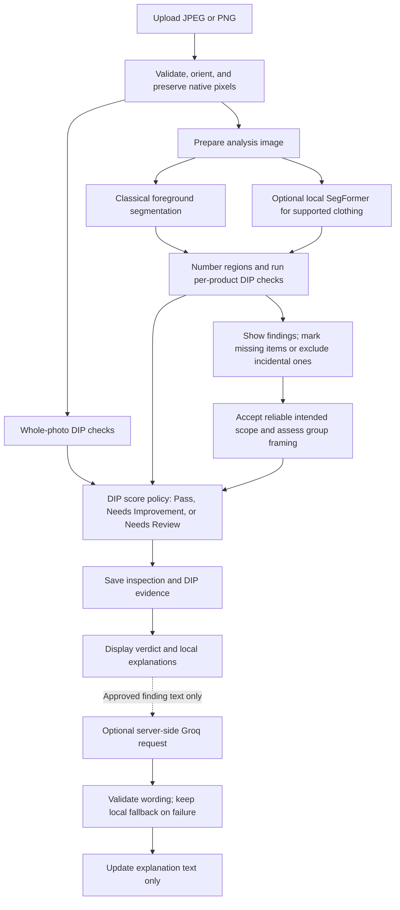

# Framecheck

**HSR-AIML-056 ? Automated E-commerce Image Quality and Compliance Inspector**

Framecheck is a local Python application for reviewing product photographs. It checks the whole photo and each product region it can locate, then shows one **DIP verdict**, numbered findings, and practical advice.

The project demonstrates explainable **Digital Image Processing (DIP)**: colour-based segmentation, morphology, filtering, sharpness, contrast, noise, exposure statistics, and framing measurements. A pretrained SegFormer can help locate worn garments. Optional Groq wording explains existing findings; **DIP owns every finding and the verdict**.

> This is a course prototype with provisional thresholds. Pass means the score meets the configured threshold, required evidence is complete, and no critical defect is confirmed. It is not a marketplace approval or a guarantee of inspection accuracy.

## What it checks

| Scope | Checks |
| --- | --- |
| Whole photo | Native resolution, sharpness, contrast, noise, and severe dark/highlight detail loss |
| Each numbered product | Pixel support, sharpness, noise, tonal support, clipping warnings, possible incomplete masks, and frame-edge contact |
| Intended product group | Overall size, placement, and margins in original frame coordinates |
| Coverage | Automatic intended-product acceptance when detection is reliable; review when evidence is unresolved |

The app preserves original dimensions and uses an analysis image with a maximum long side of 512 px. Product exposure statistics use the selected mask. Mostly blank backgrounds receive a contrast guard rather than an automatic contrast rejection. Individual products do not each have to be centred.

Version 1.7 proposes separation at raw foreground gaps and flags unresolved touching-item counts. Those proposals are not verified product identities. On mostly blank reliable backgrounds, focus can use independently passing product checks while preserving the original full-frame observation. Uncertain product focus and existing calibration guards remain Review. Severe framing blocks Pass even when the score exceeds 75.

## Workflow



The default policy passes scores of **75/100 or higher** only when required evidence is complete and no critical defect is confirmed. A confirmed critical defect or a complete score below the threshold gives **Needs Improvement**. Incomplete required checks give **Needs Review**; a confirmed critical defect takes precedence. Points pending incomplete checks stay separate from points lost for confirmed problems. Excluded items and advisory findings retain their observations without deciding the verdict. Passing photos still receive practical suggestions.

Configure the provisional threshold in `data/one-click-policy.json` under `score_verdict.pass_threshold` (a finite number from 0 to 100). Invalid settings produce Needs Review. Each new inspection saves its effective policy; existing reports keep their saved verdicts. See [score policy and critical checks](docs/quality-score.md).

## Run locally

Use **Python 3.12 or newer** and run from the repository root. The standard inspection flow needs no API key, dataset download, or neural-model weights.

### Windows PowerShell

```powershell
python -m venv .venv
.\.venv\Scripts\python.exe -m pip install -r requirements.txt
.\.venv\Scripts\python.exe app.py --port 8505
```

### Linux or macOS

```bash
python3 -m venv .venv
.venv/bin/python -m pip install -r requirements.txt
.venv/bin/python app.py --port 8505
```

Open **http://127.0.0.1:8505/**. The application creates its local SQLite database when an inspection is saved. Restart the Python process after changing backend code.

## Inspect a photo

1. Upload or drop a nonanimated JPEG/PNG, up to 10 MiB and 24 megapixels.
2. Read the completed whole-photo and numbered-product findings.
3. Uncheck incidental items, such as trousers in a tops-only listing.
4. Mark missing products. If a candidate merges several items, mark them separately and exclude the merged candidate.
5. Reliable detections accept intended-product coverage and evaluate group framing automatically. Confirm or correct the selection only when evidence is unresolved or your intended products differ.
6. Open **Details** for masks, scores, thresholds, calibration notes, or the downloadable JSON report.

A suggestion beside the verdict opens the relevant evidence, original-size photo, or item-selection controls. On phones this action appears before the photo and product cards. Mark separate products and exclude a combined candidate when a region contains several items.

Confirmation establishes user intent. It **does not verify mask accuracy** or clear outstanding quality/mask Reviews. Marking and confirmation save new child inspections; earlier reports remain unchanged. Advanced category/profile tools are available at `/?advanced=1`.

Localization is reused within a bounded in-memory cache; every new inspection recomputes DIP findings and its score. Details timing includes evidence encoding. Upload/correction `Server-Timing` headers also measure committed storage and application request time. No cache or new verdict is applied retrospectively to saved reports. See [scope, severity, timing, and remaining validation limits](docs/quality-score.md).

## Optional clothing localization

Plain-background foreground inspection works without SegFormer. To enable the existing local clothing parser, install the optional garment dependencies and supply the matching checkpoint weights as described in [models/README.md](models/README.md).

The weights are not included in Git. No model is automatically downloaded or trained. Without suitable localization, available photo findings remain visible and the user can mark a product.

## Optional Groq explanations

Use [.env.example](.env.example) as the template for a local `.env` file:

```dotenv
GROQ_API_KEY=
GROQ_MODEL=openai/gpt-oss-20b
```

Enter your own key only in the ignored `.env` file. The server reads settings when explanations are requested. Nonempty process environment settings take precedence.

Groq receives approved finding IDs, statements, and fixes?not the photo or filename. Friendly summaries use evidence-approved phrase alternatives and exact finding references; unsupported claims are rejected. Missing configuration, invalid claims, timeouts, and network/provider errors retain local wording and the saved DIP verdict. The app works without Groq.

## Tests

Using the virtual environment's Python:

```bash
python -m pip install -r requirements-dev.txt
python -B -m pytest -q -p no:cacheprovider --basetemp .pytest-work
```

Most tests generate their own images, masks, and temporary databases. Eleven optional regressions use local private shoe photos and are skipped when those files are absent. No API key, pretrained weights, private database, or downloaded dataset is needed for the public test suite.

GitHub Actions is configured to run the public suite on Windows and Ubuntu with Python 3.12. See [evaluation and limitations](docs/evaluation.md) for the distinction between software verification and inspection accuracy.

## Project layout

```text
app.py                   Local application entry point
inspector/               DIP measurements, localization, decisions, UI, storage, narration
scripts/                 Dataset, calibration, evaluation, and verification tools
tests/                  Procedural regression tests and optional local-photo checks
data/                   Published runtime configuration; ignored local datasets/database
models/                 Checkpoint metadata; ignored optional weights
docs/evaluation.md      Results, evidence boundaries, and remaining validation gaps
```

The research scripts preserve the course's earlier experiments. Dataset generation, historical comparisons, and live-browser evidence scripts require their separately retained local assets; they are not part of first-run setup.

## Data, evaluation, and limits

The default flow uses a provisional normal-resolution policy. Blur Fail ranges remain guarded because the available holdout exposed false failures. Local contrast/clipping and incomplete-mask checks are conservative warnings, not broadly calibrated defect classifiers.

Historical small-photo evaluation improved blur recall from 2% to 63% on known labels, but used AI-reviewed labels and synthetic variants. Those results do not establish current normal-resolution accuracy. Touching, hidden, small, or low-contrast products can still be missed or merged. Human-verified masks and a representative independent natural-defect dataset remain future work. Full details are in [docs/evaluation.md](docs/evaluation.md).

The publication includes only the small runtime policy and guarded-profile records under `data/`. Uploaded photos, SQLite databases, raw datasets, generated reports, browser profiles, course-export bundles, pretrained weights, and local cleanup backups remain ignored. See [data/README.md](data/README.md).

For first publication, use the [GitHub publishing guide](docs/github-publishing.md). Local course evidence and existing saved inspections do not need to be deleted or uploaded.
