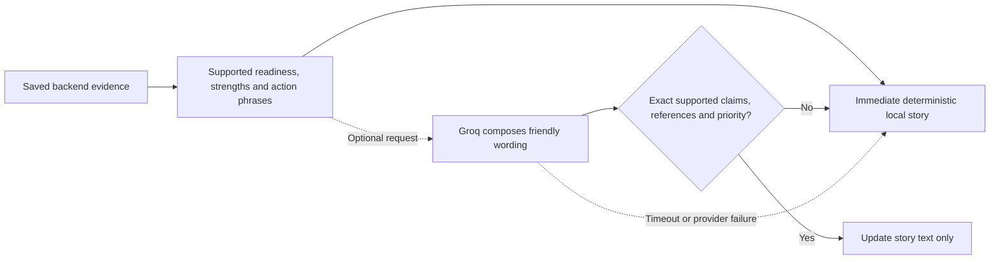

# Framecheck

### Understand your product photo before you publish it.

Framecheck reviews a product photograph, shows what looks good, and points to the areas that need attention. It combines explainable **Digital Image Processing (DIP)** with optional garment localization and friendly, evidence-grounded explanations.

**Runs locally ? Reviews multiple products ? Preserves inspection history ? Works without an API key**

> **Course prototype ? HSR-AIML-056:** Automated E-commerce Image Quality and Compliance Inspector. Its thresholds and score weights are provisional. A passing result means the configured review requirements were met; it is not a marketplace approval or a guarantee that every defect was detected.

[Get started](#get-started) ? [Use Framecheck](#use-framecheck) ? [Understand your result](#understand-your-result) ? [How it works](#how-it-works) ? [Optional features](#optional-features) ? [Troubleshooting](#troubleshooting)

## What it does

Upload a photo and receive:

- **One result:** Pass, Needs Improvement, or Needs Review, with a score out of 100.
- **A short, natural summary:** whether the photo is ready, what looks good, and up to three useful actions.
- **Numbered product regions:** findings tied to the affected item or the whole photo.
- **An optional correction:** change which items belong in the review or mark a missing product.
- **Expandable evidence:** measurements, masks, score accounting, calibration limits, and inspection history.
- **A saved report:** revisit the result or download its JSON evidence.

When the evidence supports an all-clear result, Framecheck says **?Your photo looks good.?** An incomplete check is explained separately from a confirmed problem.

### Checks at a glance

| Scope | What Framecheck examines |
| --- | --- |
| Whole photo | Original dimensions, focus, contrast, estimated graininess, and severe loss of dark or bright detail |
| Each intended product | Available detail, focus, graininess, tonal support, bright/dark-area warnings, possible incomplete outlines, and proximity to photo edges |
| Selected product group | How much of the original frame the group fills, its placement, and space around its edges |
| Product selection | Whether the detected and selected regions provide enough evidence to assess the intended products |

The default flow suits clearly separated products on reasonably plain backgrounds. The optional clothing parser extends localization to supported person-and-garment scenes. Manual marking remains available when automatic localization is uncertain.

## Get started

### Requirements

- **Python 3.12 or newer**
- A browser on the same computer
- Internet access to install dependencies; the standard local review does not require a provider connection

The core application needs **no dataset download, API key, pretrained weights, or training step**.

Run the following commands from the repository root.

### Windows PowerShell

```powershell
python -m venv .venv
.\.venv\Scripts\python.exe -m pip install .
.\.venv\Scripts\python.exe app.py --port 8505
```

### macOS or Linux

```bash
python3 -m venv .venv
.venv/bin/python -m pip install .
.venv/bin/python app.py --port 8505
```

Open **http://127.0.0.1:8505/**. The application creates its local SQLite database when an inspection is saved. Restart the Python process after changing backend code.

## Inspect a photo

1. Upload or drop a nonanimated JPEG/PNG, up to 10 MiB and 24 megapixels.
2. Read the completed whole-photo and numbered-product findings.
3. Uncheck incidental items, such as trousers in a tops-only listing.
4. Mark missing products. If a candidate merges several items, mark them separately and exclude the merged candidate.
5. Confirm that every intended product is numbered. New inspections remain Review until this step; a supported single-product result can then Pass.
6. Open **Details** for masks, scores, thresholds, calibration notes, or the downloadable JSON report.

Confirmation establishes user intent. It **does not verify mask accuracy** or clear outstanding quality/mask Reviews. Marking and confirmation save new child inspections; earlier reports remain unchanged. Advanced category/profile tools are available at `/?advanced=1`.

## First-time setup notes

- Ensure Python 3.12 or newer is installed.
- Run the commands from the repository root directory.
- Keep the virtual environment active by using its Python executable for subsequent commands.
- The application runs locally and can be accessed through your browser.
- No Groq API key or pretrained model weights are required for the standard inspection workflow.
  
### Optional clothing localization

Plain-background foreground inspection works without SegFormer. To enable the existing local clothing parser, install the optional garment dependencies and supply the matching checkpoint weights as described in [models/README.md](models/README.md).

The weights are not included in Git. No model is automatically downloaded or trained. Without suitable localization, available photo findings remain visible and the user can mark a product.

## Optional features

### Local clothing localization

The standard foreground flow works without neural weights. For supported worn-garment scenes:

1. Install the garment extra using the virtual environment:

   ```powershell
   .\.venv\Scripts\python.exe -m pip install ".[garment]"
   ```

   On macOS/Linux, use `.venv/bin/python` instead.

2. Follow [the checkpoint setup guide](models/README.md) to obtain the matching local safe weights.
3. Place them at `models/segformer_b2_clothes/model.safetensors` and restart the app.

The loader runs on CPU. It does not automatically download weights, train a model, or substitute random predictions when weights are missing. Garment masks remain estimated, unverified regions.

### Friendly Groq explanations

The local fallback is available immediately and requires no API key. To enable Groq wording, create or edit an ignored `.env` file using [.env.example](.env.example):

```dotenv
GROQ_API_KEY=
GROQ_MODEL=openai/gpt-oss-20b
```

Add your own key after `GROQ_API_KEY=`. Nonempty process environment values take precedence. Settings are read when explanations are requested, so editing the local key does not require restarting the app.



The provider can choose supported wording alternatives and reorder strengths. It cannot invent claims, swap product scopes, turn uncertainty into a defect, change action priority, or override readiness. Validation rejects extra, missing, duplicate, misplaced, or unsupported claims. This deliberately bounds phrasing rather than claiming to validate arbitrary free-form language.

The backend keeps scores, verdicts, raw findings, and the technical score explanation. Missing configuration, invalid output, timeouts, and network/provider failures preserve the complete local story.

## Privacy and storage

| Data or behavior | Handling |
| --- | --- |
| Uploaded photo and image evidence | Stay in the local application and SQLite storage; not sent to Groq |
| Optional explanation request | Includes referenced finding text, approved wording alternatives, and backend score evidence |
| Filename and local filesystem paths | Not included in the explanation request |
| API key | Used server-side for provider authentication; never included in the prompt or page |
| Saved history | Stored in `data/inspections.sqlite3` by default |
| Local assets and credentials | Photos, databases, reports, weights, browser profiles and `.env` are ignored by Git |

The bundled HTTP server binds to **127.0.0.1** and is intended for local use. It is not a production service with user accounts or multi-user access controls.

To preserve history, back up the database while the app is stopped. A fresh checkout does not include private photos, prior inspections, datasets, or model binaries. See [local data and runtime configuration](data/README.md).

## Performance and implementation notes

- DIP measurements use an analysis image with a maximum long side of **512 px**; native dimensions and coordinates are retained separately.
- Garment output uses native-coordinate bilinear logit interpolation. Class streaming reduces intermediate memory without replacing it with resized hard labels.
- Localization reuse is process-local, bounded to **four entries / 48 MiB of measured arrays**, and keyed by input, implementation and checkpoint signatures.
- A separate evidence cache holds at most **four entries / 48 MiB of immutable PNG bytes**, bound to the input and ordered masks.
- Fresh inspections recompute checks and scores even when localization or evidence is reused.
- Evidence uses lossless PNG compression. Faster compression may produce larger files.
- Details records processing, localization and evidence work. Upload/correction `Server-Timing` also measures storage and application request time.
- Cold Torch/Transformers imports and package scans can dominate the first garment inspection. A fast cached result does not imply a fast cold start.

Caches are cleared when the process restarts. They do not update old reports. Processing timing excludes subsequent browser rendering/network transfer and optional explanation generation. See [the detailed runtime policy](docs/quality-score.md) for cache, coordinate and timing contracts.

## Testing and verification

### Install development dependencies

```powershell
.\.venv\Scripts\python.exe -m pip install ".[dev]"
```

Use `.venv/bin/python` on macOS/Linux. [requirements-dev.txt](requirements-dev.txt) provides the pinned development snapshot as an alternative.

### Run the public suite

```powershell
.\.venv\Scripts\python.exe -B -m pytest -q -p no:cacheprovider --basetemp .pytest-work
```

Most tests use generated images and temporary databases. Optional private-photo regressions skip when their local fixtures are absent. Neural-model-specific tests can also skip when their optional dependency is unavailable. Public checks do not require an API key, downloaded dataset, private inspection history, or model checkpoint.

### Run focused frontend and explanation checks

```powershell
.\.venv\Scripts\python.exe -B -m pytest tests/test_story.py tests/test_friendly_results.py tests/test_narration.py tests/test_score_intent.py tests/test_current_repairs.py tests/test_intended_selection.py tests/test_audit_improvements.py tests/test_web.py tests/test_score_policy.py -q -p no:cacheprovider
```

These cover supported all-clear language, scoped improvements, incomplete checks, strict provider validation, deterministic fallback, product selection, history, and backend-owned scoring. Provider behavior is mocked; passing these checks does not establish live Groq connectivity or inspection accuracy.

### Optional browser verification

```powershell
.\.venv\Scripts\python.exe -B -m scripts.verify_current_repairs friendly
```

This local verifier uses an isolated database and headless Chrome. It checks **1360 px desktop** and **390 px mobile**, including saved single- and multi-product photos, provider-text updates, evidence links and corrected/reprocessed history. It requires the separately retained native-photo records and the configured local Chrome installation. It uses a validated local provider double and makes no live Groq calls.

GitHub Actions is configured for Windows and Ubuntu with Python 3.12. Configuration is not a claim that a particular remote CI run passed.

## Project map

```text
app.py                         Local application entry point
inspector/
  web.py                       HTTP routes, uploads and report access
  modern_ui.py                 Responsive upload and result pages
  auto_inspect.py               Default detection, selection and inspection flow
  segmentation.py              Classical foreground segmentation
  garments.py                  Optional local garment model and native labels
  product_measurements.py      Scoped image and framing measurements
  scoring.py                   Fixed point budget and verdict gates
  story.py                     Friendly, evidence-approved story alternatives
  narration.py                 Groq request, validation and local fallback
  storage.py                   SQLite report and evidence storage
  profiles.py                  Advanced profile integrity checks
scripts/                       Evaluation, calibration and verification tools
tests/                         Unit, regression and HTTP contracts
data/                          Published runtime configuration; ignored local data
models/                        Checkpoint metadata; ignored optional weights
docs/                          Policy, evaluation, annotation and publication guides
```

NumPy, OpenCV and Pillow support image processing. The local web server and SQLite integration use Python's standard library. scikit-learn supports evaluation tooling. Torch, Transformers and safe checkpoint weights are optional for garment localization.

Research scripts preserve earlier course experiments. Their separately retained datasets and assets are not first-run application requirements.

## Troubleshooting

| Symptom | What to do |
| --- | --- |
| The example URL does not open | Keep the server terminal running. Match the URL to `--port`; the default without that argument is 8501 |
| The port is already in use | Start with another port, such as `--port 8506`, then open the matching URL |
| No product was located | Read the available photo checks, then mark a visible intended product; complex scenes may need the optional parser |
| An incidental item was counted | Use **Change products (optional)** and save the intended selection |
| Two touching products became one region | Mark them separately, exclude the combined candidate, and confirm the intended selection |
| A high score still says Needs Review | Read the incomplete check. Pending evidence and confirmed defects are different; confirming selection cannot resolve independent focus uncertainty |
| Groq wording is unavailable | Check `.env`, process-environment precedence, and the explanation source under Details. Local wording remains available |
| The first garment review is slow | Dependency/model initialization can dominate cold processing. Compare localization and encoding timings under Details |
| A saved correction still shows older measurements | This preserves provenance. Reinspect the original to establish current measurements and profile |
| An advanced profile fails integrity checks | Restore its matching original profile/calibration/core files; the loader deliberately rejects changed calibration provenance |
| The file is rejected | Check JPEG/PNG format, animation, 10 MiB size and 24 MP limits. Prefer an appropriate original instead of enlarging a small file |

The local health endpoint is `http://127.0.0.1:8505/health` when using the example port.

## Evaluation and known limits

Framecheck demonstrates explainable assisted review. **Software correctness, localization overlap, defect-detection accuracy and marketplace acceptance are different claims.**

- Thresholds, fixed weights and composition rules are provisional, not broadly validated marketplace standards.
- Touching, overlapping, hidden, small or low-contrast products can be missed or merged. Geometry cannot establish listing intent with certainty.
- Product masks are estimated. A passing outline warning does not mean a human verified the mask.
- Blur Fail ranges remain guarded because earlier holdouts exposed false failures. Review is intentional where the evidence cannot support a definitive judgment.
- Natural black, white or uniform material can resemble clipping or lost detail; local warnings are conservative.
- Independent human-labelled natural defects, verified product instances/masks, and broader category coverage remain needed.
- Cold-start and large-image/concurrent-load behavior need broader benchmarking. Small local timing samples are not a performance guarantee.
- Groq phrasing is restricted to supported alternatives. Provider availability does not affect the saved DIP result.

Historical small-photo experiments reported improvements on their own datasets, including synthetic variants and AI-reviewed labels. Those results do **not** establish current normal-resolution field accuracy. The [evaluation record](docs/evaluation.md) contains earlier pipeline snapshots and their evidence boundaries; use this README and the [current quality policy](docs/quality-score.md) for present behavior.

## Further reading

| Guide | Purpose |
| --- | --- |
| [Quality score and evidence policy](docs/quality-score.md) | Weights, verdict gates, intended scope, provenance, caching and explanation contracts |
| [Historical evaluation and limitations](docs/evaluation.md) | Earlier experiments, validation scope and remaining data requirements |
| [Annotation rubric](docs/annotation-rubric.md) | How reference labels and uncertainty should be recorded |
| [Optional checkpoint setup](models/README.md) | Local garment dependencies, metadata and weight placement |
| [Runtime configuration and local data](data/README.md) | Published configuration versus ignored private artifacts |
| [GitHub publishing guide](docs/github-publishing.md) | Preparing the source without distributing private data or secrets |
